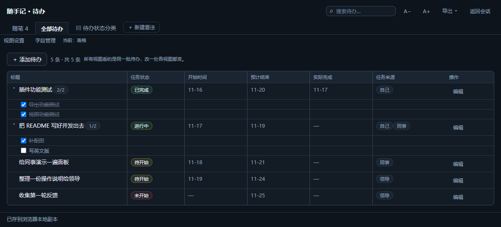
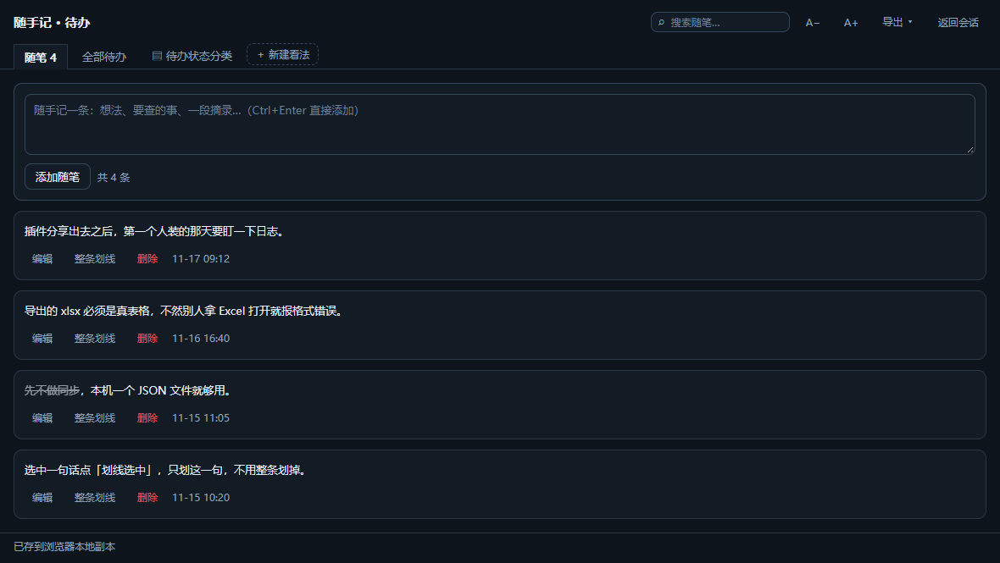
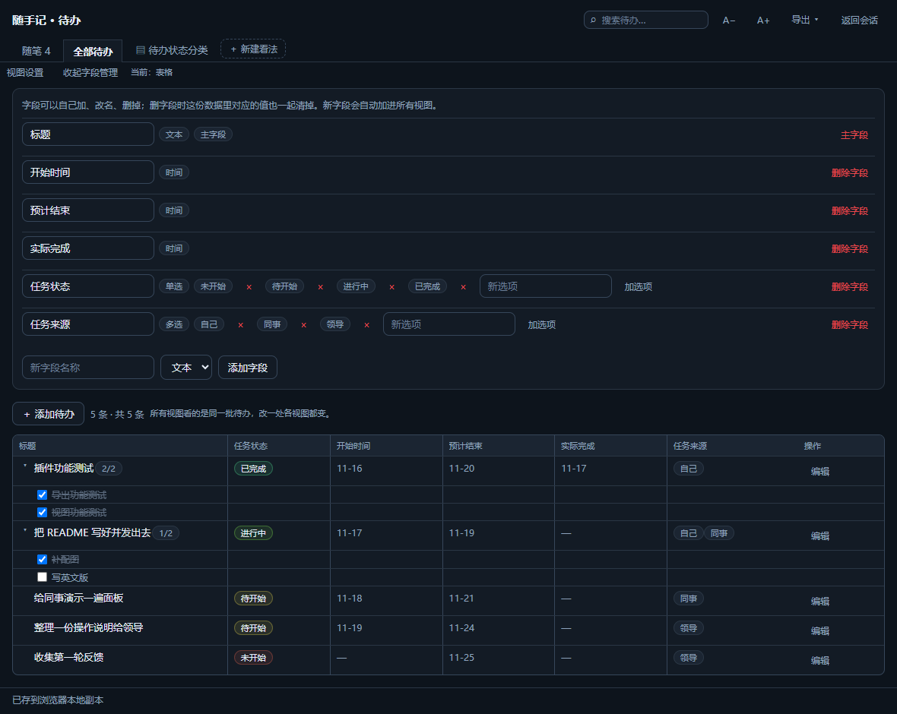
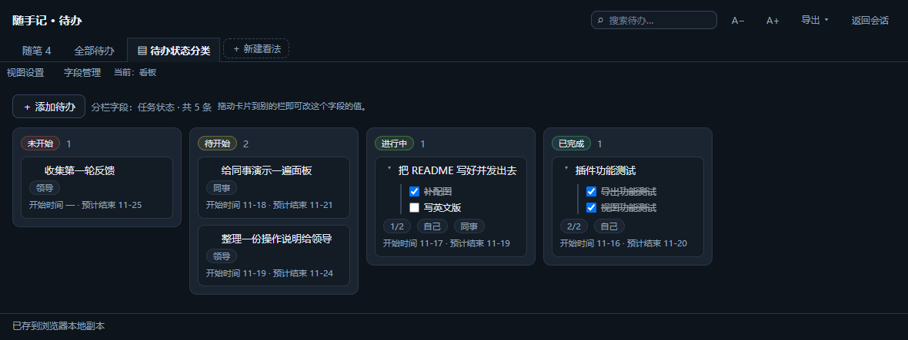
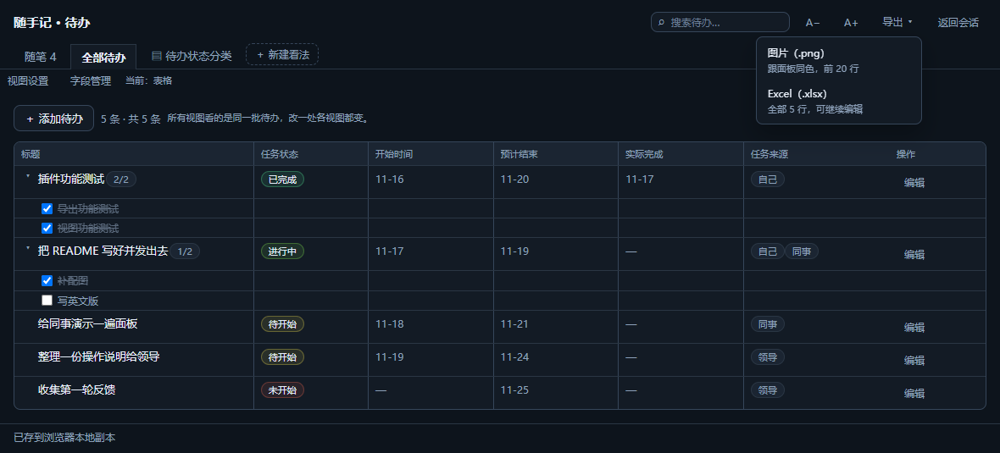
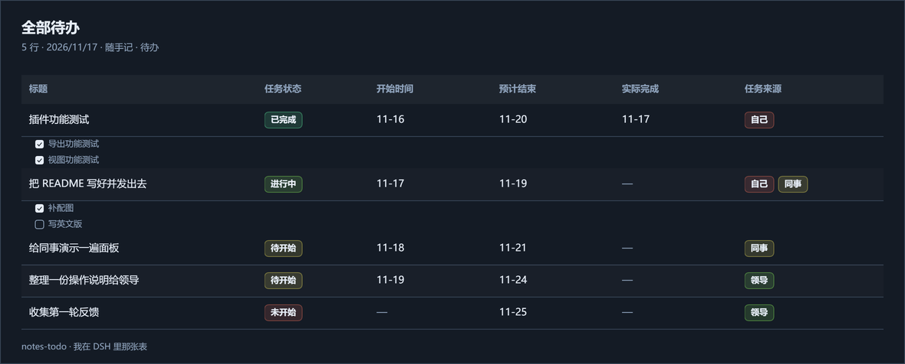
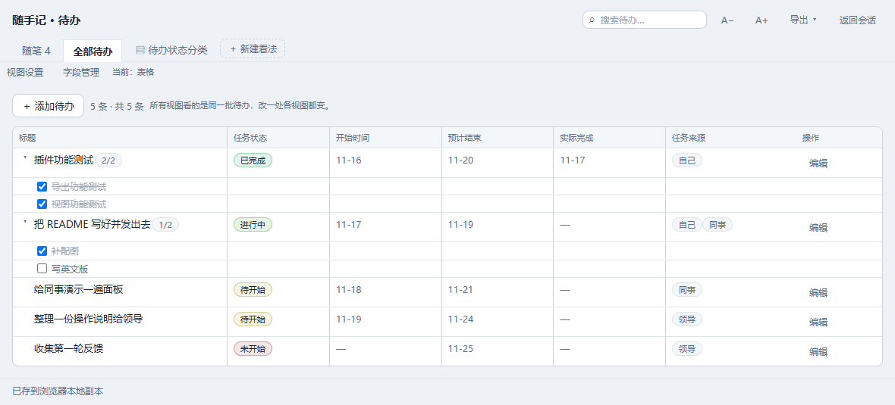

# Notes & Todo

> A panel in the DeepSeek Harness sidebar: jot notes freely, track todos in a table you shape yourself. Everything stays in one JSON file on your machine.

[中文](./README.md) · [Install](#install) · [For AI agents](#for-ai-agents-three-tools-and-a-prompt-section)



One more icon in the left sidebar, and it opens two tabs. **Notes** is for whatever you want to write down — strike out a whole note, or just one sentence of it. **Todo** is a table whose fields you define; fields, views, column widths and filters are all yours, and the same records can be seen as a table, a board or a calendar.

No network, no upload, no sync. Data lives in `~/.dsh/plugin-data/notes-todo/store.json` — backing up means copying that one file.

## Contents

- [Where to find it](#where-to-find-it)
- [Notes](#notes)
- [Todo](#todo)
- [Fields](#fields)
- [Views](#views)
- [Subtasks](#subtasks)
- [Search](#search)
- [Export](#export)
- [Text size](#text-size)
- [Templates](#templates)
- [For AI agents: three tools and a prompt section](#for-ai-agents-three-tools-and-a-prompt-section)
- [Where the data lives](#where-the-data-lives)
- [Install](#install)
- [Upgrading never overwrites your data](#upgrading-never-overwrites-your-data)
- [Limitations](#limitations)

## Where to find it

Look for a document-style icon in the left sidebar; hovering shows **Notes & Todo**. Click it and the panel takes the main area; the **Back to conversation** button at the top right returns you to the chat.

## Notes



Type into the box at the top and press `Ctrl+Enter`, or click **Add note**. Each note can be edited and deleted — deleting asks for a second click.

**Two ways to strike out.** Select some text and click **Strike selection** to strike just those words; click it with nothing selected to strike the whole note. Strikes are stored as `~~text~~`, so you can see them in the editor, understand them, and edit them by hand.

## Todo

Underneath it is one **table with fields you define**. Every view reads the same records, so changing a value in one place changes it everywhere.

## Fields



**Field management** lets you add, rename and delete fields. Deleting a field also drops its values from the data; a new field is appended to every view.

There are four types:

| Type | Meaning |
|---|---|
| Text | Plain text |
| Date | A date, optionally with a time of day |
| Select | One option from a list you maintain |
| Multi-select | Several options |

Options for select and multi-select are yours to add and remove, and colours are assigned automatically.

## Views

**+ New view** creates *another way of looking at the same todos*, not a new table. Pick a type when you create it:

- **Table** — Excel-like. Click a header to sort (ascending → descending → off), drag headers to reorder, drag the right edge of a column to resize. Rows can be grouped and collapsed.
- **Board** — columns driven by a select field; dragging a card to another column changes that field.
- **Calendar** — laid out by month, based on one date field.



Each view keeps its own columns (which ones, in what order, how wide), filters (several conditions, AND/OR), sorts and grouping. View settings let you rename the tab or delete the view.

Filter **contains** takes several values at once; **equals** takes exactly one.

## Subtasks

Every todo can carry a checklist. A small triangle sits in front of the main row and costs no extra line when collapsed; when expanded, subtasks are indented into the **same column grid** as the main row, not nested in a little table of their own.

The main row shows progress like `1/2`.

## Search

The box in the toolbar searches the displayed text of every field, subtask text included. Separate words with spaces — every word has to hit.

Searching only filters what is shown; it does not touch the data or the view's own filter settings.

## Export



One **Export ▾** button at the top right; the formats it offers follow the **current tab**.

**Todo views** (table / board / calendar):

- **Image (.png)** — paints the current view as a share card. Colours follow the active theme (both dark and light are tested), select and multi-select render as the same coloured chips you see in the panel, the first 20 rows are drawn, subtasks sit under their parent, and anything left over is noted as "N more rows not drawn".

  

- **Excel (.xlsx)** — a real xlsx, not a CSV with a renamed extension, so Excel opens it without the format warning. Columns are the view's columns, **every row** is exported (no 20-row cap), select and multi-select write option names, dates use the same `11-20 18:00` form the table shows, and the last column carries subtasks as `1/2: ✓ first; · second`.

**The notes tab:**

- **Markdown (.md)** — newest first, one `### <time>` section per note, whole-note strikes written as `~~…~~`.

Exports cover **what you have searched or filtered to**, not the whole store. Files land in the browser's download folder, named after the view (notes use `随笔-日期.md`).

## Text size

`A−` / `A+` at the top right scale the whole panel (0.85×–1.6×). The default is guessed from the window width, because 13px feels small on a wide screen. The choice is remembered in the browser.

## Templates

When there is no table at all, the panel offers three ready-made ones: **Weekly report** (table + status board), **Topic backlog** (table + status board) and **Watchlist**. One click gives you fields, views and a few example rows, so you do not start from a blank grid.

## For AI agents: three tools and a prompt section

The table is not only usable from the panel. The plugin registers three tools with the model, and they read and write the **same** `store.json`:

| Tool | What it does |
| --- | --- |
| `notes_table_schema` | Reads fields (name / type / options), view names and row counts |
| `notes_table_query` | Returns rows applying one view's filters and sorts, plus an optional keyword |
| `notes_table_upsert` | Creates a row or updates one, addressed by field name |

So you can simply say:

- "Put the requirements we just discussed into the table" — it reads the schema, fills the fields and writes a row;
- "What is still in progress?" — it calls query and answers;
- "Move the website redesign deadline to December 20" — it finds the row and updates that date field.

The plugin also injects a short section into the system prompt (current field list, view names, row count) so the model knows the table exists; it rewrites that section when the schema changes, so it stays cheap.

The panel reconciles against the file every 4 seconds, so a write from the model shows up without a manual refresh — and it skips a tick while you have a save in flight, so it will not clobber what you are typing.

Use the field's own name (`标题`, `状态`), write option names for select and multi-select, and use `YYYY-MM-DD` or `YYYY-MM-DDTHH:mm` for dates. A wrong option is rejected with the list of valid values.

## Where the data lives

Host side: `~/.dsh/plugin-data/notes-todo/store.json` (on Windows, `C:\Users\<you>\.dsh\plugin-data\notes-todo\store.json`). Writes are atomic — a `.tmp` file is renamed into place — so a crash cannot leave a half-written file.

The browser keeps a localStorage copy as well: the panel paints that copy first and then reconciles with the file, so a slow read never shows a blank panel.

**Backing up means copying that store.json.** To move machines, put it at the same path.

All colours come from DSH theme tokens, so light mode follows along:



## Install

Paste the repository URL into **Plugins** → **Add plugin**:

```
https://github.com/lzjloveyjx/dsh-plugin-notes-todo
```

Refresh the page afterwards and the sidebar icon appears.

You can also install from a command line. Inside `~/.dsh/profiles/<profile>`:

```bash
node "<DSH install dir>/resources/runtime/primary-runtime/dependencies/pnpm/bin/pnpm.cjs" add -w dsh-plugin-notes-todo
```

Then add the package name to the `dsh.profile.bundles` array in that directory's `package.json`. **Restart DSH afterwards** — the bundle layer is only assembled at startup.

## Upgrading never overwrites your data

The data file lives in `~/.dsh/plugin-data/notes-todo/`, **not inside the plugin directory**, so upgrading, reinstalling or removing the plugin leaves it alone.

On top of that there are two more safeguards:

**① The first write of each version leaves a snapshot.** The filename records the version span, for example:

```
store.json.v1.4.3-to-v1.4.4.2026-11-17T07-55-34-976Z.bak
```

One snapshot per version, so repeated saves do not pile up files. The version marker lives in a sidecar file, `store.json.writer`, so the store itself stays clean.

**② An unreadable file is copied aside before anything else.** If `store.json` is damaged (half a JSON document, truncated, bad encoding), the plugin first copies it to `store.json.unreadable-<time>.bak` and then continues with an empty table. The original bytes stay in that copy untouched.

Older versions had no such guard: one failed parse meant an empty in-memory table, and the next save wrote that emptiness back.

To roll back, copy the matching `.bak` over `store.json`. No configuration needed.

## Limitations

- Web platform only (`platform: web`).
- No network access; nothing is uploaded.
- Fields and views are global, not per-session.
- Disabling the plugin removes the sidebar icon; the data file stays.

## License

MIT
