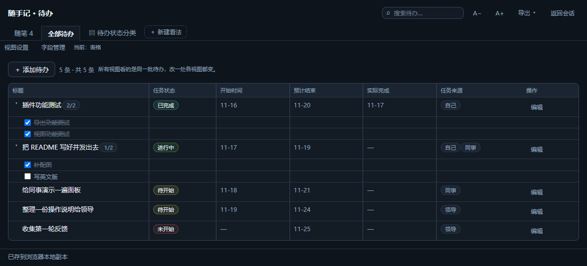
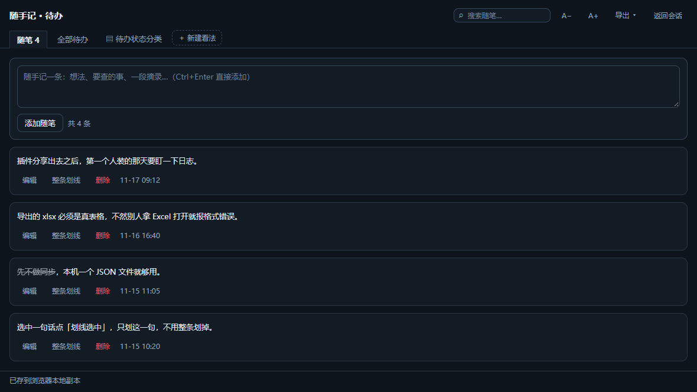
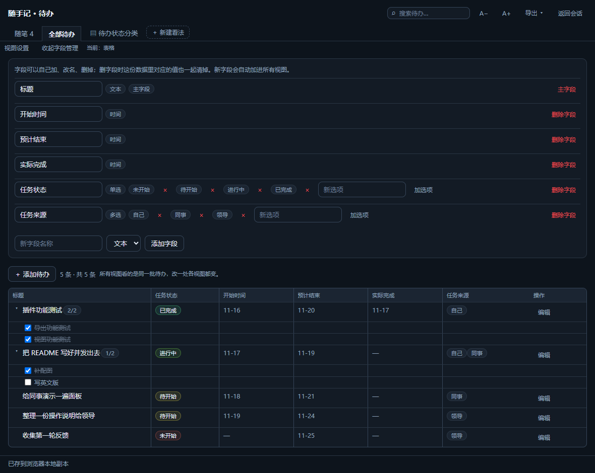
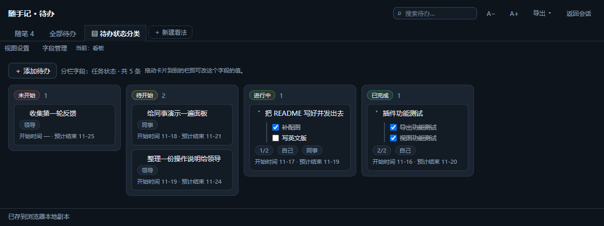
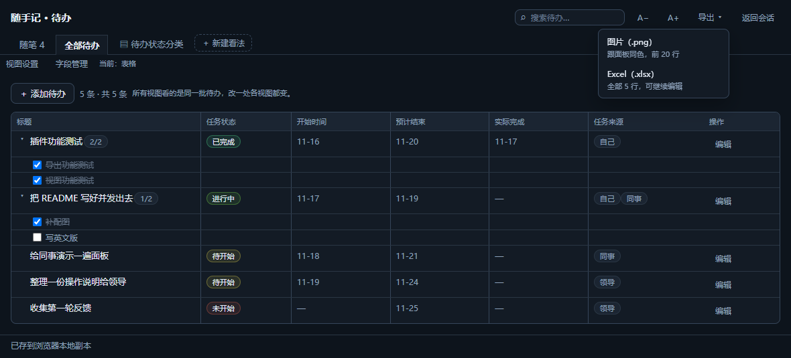
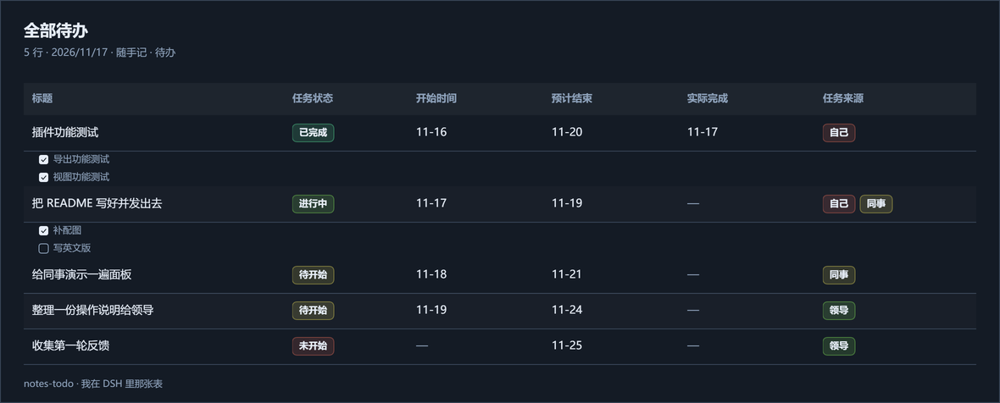
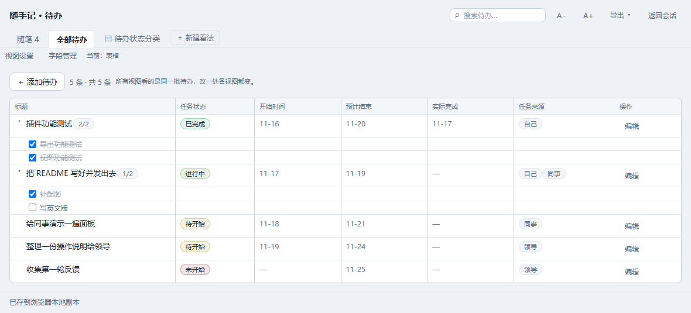

# 随手记 · 待办

> DSH 左侧栏里的一个面板：随笔随便写、待办像表一样排，数据就躺在本机一个 JSON 文件里。

[English](./README.en.md) · [安装](#安装) · [给 AI 用](#给-ai-用三个工具--一段提示词)



左边栏多一个图标，点开是两个标签页。**随笔**是想到什么写什么，能整条划掉、也能只划掉一句话；**待办**是一张你自己定字段的表，字段、视图、列宽、筛选全归你，同一批待办可以有表格、看板、日历几种看法。

不联网、不上传、不同步。数据在 `~/.dsh/plugin-data/notes-todo/store.json`，备份就是复制这个文件。

## 目录

- [装完之后去哪儿找](#装完之后去哪儿找)
- [随笔](#随笔)
- [待办](#待办)
- [字段](#字段)
- [视图](#视图)
- [子任务](#子任务)
- [搜索](#搜索)
- [导出](#导出)
- [字号](#字号)
- [模板](#模板)
- [给 AI 用：三个工具 + 一段提示词](#给-ai-用三个工具--一段提示词)
- [数据存在哪](#数据存在哪)
- [安装](#安装)
- [升级不会覆盖你的数据](#升级不会覆盖你的数据)
- [限制](#限制)

## 装完之后去哪儿找

左侧栏图标里找一个文档样式的图标，悬停显示「随手记 · 待办」。点一下右侧主区域就是面板；面板右上角「返回会话」回到对话。

## 随笔



上面一个输入框写内容，`Ctrl+Enter` 直接添加，或点「添加随笔」。每条可编辑、可删除，删除要点两次确认。

**划线有两种**：选中一段文字点「划线选中」，只划这几句；不选文字直接点，划掉整条。划线在存储里用 `~~文本~~` 标记，编辑框里看得见、看得懂、也能手改。

## 待办

本质是一张**自定义字段的表**，所有视图看的是同一批记录，改一处各视图都变。

## 字段



「字段管理」里能自己加、改名、删。删字段时这份数据里对应的值一起清掉；新字段自动加进所有视图。

类型只有四种：

| 类型 | 说明 |
|---|---|
| 文本 | 普通文字 |
| 时间 | 日期，点一下可选到具体几点 |
| 单选 | 一个选项，选项自己加 |
| 多选 | 多个选项 |

单选和多选的选项随便加、随便删，颜色自动分配，不用你操心。

## 视图

「＋ 新建看法」造的是**同一批待办的另一种看法**，不是新表。新建时选类型：

- **表格**：像 Excel。点表头排序（升序→降序→不排序），拖表头换列序，拖列右边缘改列宽。组内可分组、可折叠。
- **看板**：按一个单选字段分栏，卡片拖到别的栏就是改这个字段的值。
- **日历**：按月排，需要一个时间字段作依据。



每个视图有独立的列（显示哪些、顺序、宽度）、筛选条件（多条件，且/或）、排序、分组。视图设置里能改标签页名称，也能删掉这个视图。

筛选的「包含」是多选，可以一次勾好几个词；「等于」是单选，只能挑一个。

## 子任务

每条待办可挂子任务清单。主行最前面有个小三角，折叠时不占额外一行；展开时子任务按缩进排在与主行**同样的列结构**里，不是套一张小表。

主行会显示 `1/2` 这样的进度。

## 搜索

顶栏搜索框搜所有字段的显示文字，子任务的文字也算。多个词用空格分开，每个词都命中才算。

搜索只筛显示，不动数据、不动视图的筛选设置。

## 导出



右上角一个「导出 ▾」，点开选格式——可选项跟着**当前标签页**走：

**待办视图**（表格 / 看板 / 日历）：

- **图片（.png）**：把当前视图画成一张分享卡。颜色跟当前主题走（深色浅色都试过），单选、多选是彩色小标签，和面板里同一套；画前 20 行，子任务跟在行下面，超出的注明「还有 N 行没画进来」。

  

- **Excel（.xlsx）**：真正的 xlsx（不是改后缀的 CSV，Excel 打开没有「格式不符」的警告）。列就是当前视图的列，**全部行**都导（不受 20 行限制），单选/多选写选项名、时间写表格里显示的那种 `11-20 18:00`，最后一列是子任务——`1/2：✓ 子任务甲；· 子任务乙`，进度和各条内容都在。

**随笔标签页**：

- **Markdown（.md）**：按时间倒序，每条一个 `### 时间` 小节，整条划掉的写成 `~~…~~`。

导出的都是**当前搜过/筛过的结果**，不是全库。文件落进浏览器默认下载目录，文件名是视图名（随笔是 `随笔-日期.md`）。

## 字号

右上角 `A−` / `A+` 调整整个面板的字号（0.85–1.6 倍），默认按窗口宽度猜一个——宽屏上原来 13px 偏小。选择记在浏览器里，下次打开还是这个大小。

## 模板

一张表都还没有的时候，面板会给出三张现成模板：**周报**（表格 + 状态看板）、**选题库**（表格 + 状态看板）、**追番**。点一下就有字段、视图和几行示例，不用从空白开始搭。

## 给 AI 用：三个工具 + 一段提示词

这张表不只在面板里可用。插件向模型注册了三个工具，模型调它们时读写的是**同一份** `store.json`：

| 工具 | 干什么 |
| --- | --- |
| `notes_table_schema` | 读字段（名字/类型/选项）、视图名、行数 |
| `notes_table_query` | 按某个视图的筛选与排序取行，可加关键词搜索 |
| `notes_table_upsert` | 按字段名新建一行或更新某一行 |

所以可以直接跟它说：

- 「把刚才聊的客户需求记进表里」——它自己查结构、填字段、写一行；
- 「表里进行中的还有哪些？」——它调 query 再回答；
- 「那条官网改版的截止改到 12 月 20 号」——它找到行、更新那个时间字段。

同时插件会往系统提示里注入一小段（当前字段清单 + 视图名 + 行数），让模型知道这张表存在；表结构变了会自动重写这段，不占多余 token。

面板每 4 秒对一次文件，模型写完不用手动刷新就看得见；保存中的那一下会跳过，不会覆盖你正在改的内容。

字段名用中文名就行（`标题` / `状态`），单选多选写选项名，时间写 `YYYY-MM-DD` 或 `YYYY-MM-DDTHH:mm`；写错选项会被拒并把这字段的可选值列出来。

## 数据存在哪

Host 侧：`~/.dsh/plugin-data/notes-todo/store.json`（Windows 下 `C:\Users\<你>\.dsh\plugin-data\notes-todo\store.json`）。原子写入（先写 `.tmp` 再改名），不会写坏。

浏览器侧另存一份 localStorage 副本，打开面板时先画本地副本再和文件对账，所以不会因为读文件慢而白屏。

**备份就是复制这个 store.json。** 换机器时把它拷到同样的路径即可。

顺带一提，面板所有颜色都走 DSH 的主题变量，浅色深色自动跟：



## 安装

把仓库地址粘到 **插件** → **添加插件**：

```
https://github.com/lzjloveyjx/dsh-plugin-notes-todo
```

安装后刷新页面，左侧栏出现图标。

也可以在命令行装（绕开桌面端的限制）。在 `~/.dsh/profiles/<profile>` 里执行：

```bash
node "<DSH 安装目录>/resources/runtime/primary-runtime/dependencies/pnpm/bin/pnpm.cjs" add -w dsh-plugin-notes-todo
```

然后把包名手工加进同目录 `package.json` 的 `dsh.profile.bundles` 数组。**装完必须重启 DSH**——bundle 层只在启动时组装。

## 升级不会覆盖你的数据

数据文件在 `~/.dsh/plugin-data/notes-todo/`，**不在插件目录里**，所以换版本、重装、删插件都不会动它。

除此之外还有两道保险：

**① 每个版本第一次写入时留一份快照。** 文件名带上跨越的版本号，例如：

```
store.json.v1.4.3-to-v1.4.4.2026-11-17T07-55-34-976Z.bak
```

同一个版本只备份一次，不会每次保存都堆一个文件。版本标记写在 `store.json.writer` 这个旁挂文件里，不污染数据本身。

**② 文件读不出来时，先另存一份再继续。** 如果 `store.json` 损坏（半个 JSON、被截断、编码坏了），插件会先复制成 `store.json.unreadable-<时间>.bak`，再用空表继续跑。原来的字节一个不改地留在那个文件里。

旧版本没有这道保险：文件一旦解析失败，内存里就是空的，下一次保存就把空表写回去，数据就真没了。

想回退：把对应版本的 `.bak` 复制回 `store.json` 即可，不用改任何配置。

## 限制

- 只跑在 Web 平台（`platform: web`）。
- 不联网，不上传任何内容。
- 视图和字段是全局的，不按会话区分。
- 关掉插件后左侧栏图标消失，数据文件保留。

## 许可

MIT
